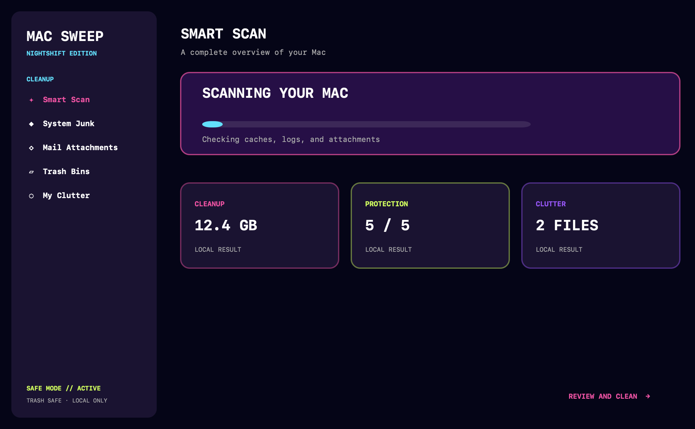

# Mac Sweep



Mac Sweep is a free, open-source macOS maintenance utility with a neon cyberpunk interface. It is designed as a privacy-first alternative to subscription cleaners: scans run locally, results are reviewable, and cleanup moves selected files to your user Trash instead of deleting them permanently.

> This project is independent software. It does not include CleanMyMac code, assets, branding, or private implementation details.

## Features

- Smart Care dashboard for cleanup, protection, performance, updates, and clutter
- System Junk scanner for user caches and logs
- Mail attachment review
- Large and old file review
- SHA-256 duplicate detection
- Applications inventory and explicit uninstall review
- Login item inspection
- Protection checks for FileVault, Firewall, Gatekeeper, SIP, and automatic updates
- Space Lens storage breakdown
- Updater inventory with locally read application versions
- Native SwiftUI interface with Liquid Glass support on compatible macOS versions
- Reversible cleanup through the macOS Trash

## Safety Model

- Smart Scan auto-selects only cache, log, and Mail attachment candidates
- Applications, login items, and Trash contents are never selected automatically
- Cleanup requires an explicit confirmation
- Cleanup rejects symlinks and paths outside the current user's home directory
- No network uploads, telemetry, subscription, or administrator password
- Protection checks are read-only and do not change system settings

Review every result before cleanup. Files in use or changed during a scan remain untouched.

## Requirements

- macOS 13 or newer
- Apple Silicon or Intel Mac
- Xcode 16 or newer recommended
- Swift 6 toolchain

## Build and Run

Run directly from the package:

```sh
swift run MacSweep
```

Build a Finder-launchable app bundle:

```sh
./build_app.sh
open ./MacSweep.app
```

Run the fabricated demo mode for screenshots or recordings. It never reads your filesystem and cannot clean anything:

```sh
MAC_SWEEP_DEMO=1 ./MacSweep.app/Contents/MacOS/MacSweep
```

Install to your user Applications folder:

```sh
ditto MacSweep.app "$HOME/Applications/MacSweep.app"
open "$HOME/Applications/MacSweep.app"
```

The terminal scanner remains available without SwiftUI:

```sh
python3 macsweep.py scan
python3 macsweep.py clean --category caches --older-than 30
```

## Tests

```sh
swift build
python3 -m unittest discover -s tests -v
```

## Privacy

Mac Sweep is local-first. It reads file metadata and selected macOS security status commands on demand. It does not transmit filenames, paths, scan results, or system status to a server.

## License

MIT. See [LICENSE](LICENSE).
